# 🚀 Blog for deployment

Day 71 of Udemy's *100 Days of Code: The Complete Python Pro Bootcamp*: a Flask blog prepared for deployment with environment variables, gunicorn, PostgreSQL and Docker. It is written for course participants and visitors who want a readable, runnable reference.

## 📚 Table of Contents

- [Overview](#-overview)
- [Requirements](#-requirements)
- [Setup](#-setup)
- [Run](#-run)
- [Lecture steps](#-lecture-steps)
- [Tests](#-tests)
- [License](#-license)
- [Links](#-links)
- [Appendix: Project documents](#-appendix-project-documents)

## 🧭 Overview

The repository follows the lecture "Learn to Deploy Your Website": put the project under version control, move secrets into environment variables, serve the app with gunicorn through a `Procfile`, and replace SQLite with PostgreSQL. Heroku has no free plan, so the deployment target is a Docker container.

| Path | Purpose |
| --- | --- |
| `src/` | The Flask application in layers: `domain`, `application`, `infrastructure`, `presentation`, plus `constants.py` |
| `main.py` | WSGI entry point, `gunicorn main:app` |
| `tests/` | pytest suite |
| `docs/` | Project documents, wiki sources and screenshots |
| `scripts/` | Screenshot capture, headless in Docker (`capture_screenshots.sh`) |
| `Doxyfile` | Doxygen configuration for the source comments |

## 📋 Requirements

- Python 3.13 or newer (the language of the course project).
- `git` to clone the repository.
- Docker, only for the container deployment.
- Optional: Doxygen to build the source documentation.

## 🛠️ Setup

Create a local virtual environment in `.venv`, upgrade pip, and install the project.

Windows (PowerShell):

```powershell
python -m venv .venv
.\.venv\Scripts\Activate.ps1
python -m pip install --upgrade pip
python -m pip install -e ".[dev]"
```

Linux and macOS:

```bash
python3 -m venv .venv
source .venv/bin/activate
python -m pip install --upgrade pip
python -m pip install -e ".[dev]"
```

## ▶️ Run

The app reads its settings from environment variables (see `.env.example`):

| Variable | Meaning |
| --- | --- |
| `FLASK_KEY` | Secret key for sessions (required) |
| `DB_URI` | Database URI; default `sqlite:///posts.db`. `postgres://` and `postgresql://` are accepted and used with psycopg 3 |
| `MAIL_USER`, `MAIL_PASSWORD` | Optional sender of the contact form |

Local run (SQLite), with the venv active:

```bash
export FLASK_KEY="$(python -c 'import secrets; print(secrets.token_hex(32))')"
python main.py
```

On Windows PowerShell use `$env:FLASK_KEY = (python -c "import secrets; print(secrets.token_hex(32))")`. The first registered user is the administrator and can write posts.

Production style run with gunicorn (Linux, as in the `Procfile`: `web: gunicorn main:app`):

```bash
gunicorn main:app
```

Docker with PostgreSQL (the free replacement for Heroku):

```bash
cp .env.example .env.docker      # then edit the two secrets
docker compose --env-file .env.docker up --build
```

The blog is then on <http://localhost:8000>. `psycopg` is installed next to the lecture's `psycopg-binary`, because the binary package alone does not contain the `psycopg` module.

## 🎓 Lecture steps

Each step of the lecture with a screenshot. The [wiki](https://git.tirsystem.com/Tirsvad-Udemy-100-days-of-code/071-blog-for-deployment/wiki) explains what each step gained, in English, Danish and Bahasa Malaysia.

### 1. Run the finished blog locally

The blog from day 69 and 70 is the starting point. Running it first proves that the code works before anything is changed, so a later problem is known to come from the deployment work.

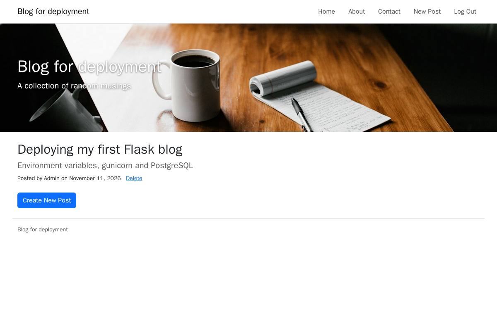

### 2. Put the project under version control

Git records every change with a message. The history can be read, compared and undone, and it is what the hosting platform deploys from.

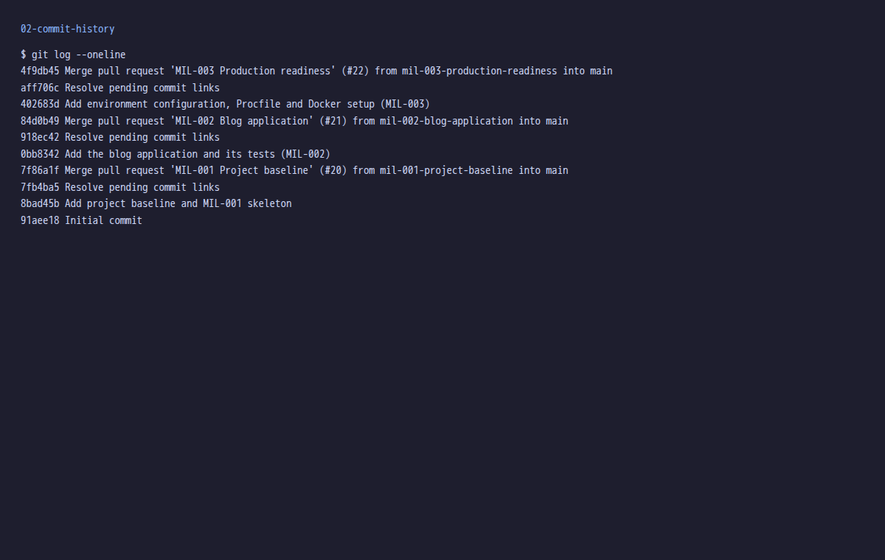

### 3. Move secrets into environment variables

The secret key, database address and mail login are no longer in the source. `FLASK_KEY`, `DB_URI` and `MAIL_*` are read from the environment, so the same code runs on a laptop and on a server and no secret ends up in the repository. `debug` is switched off.

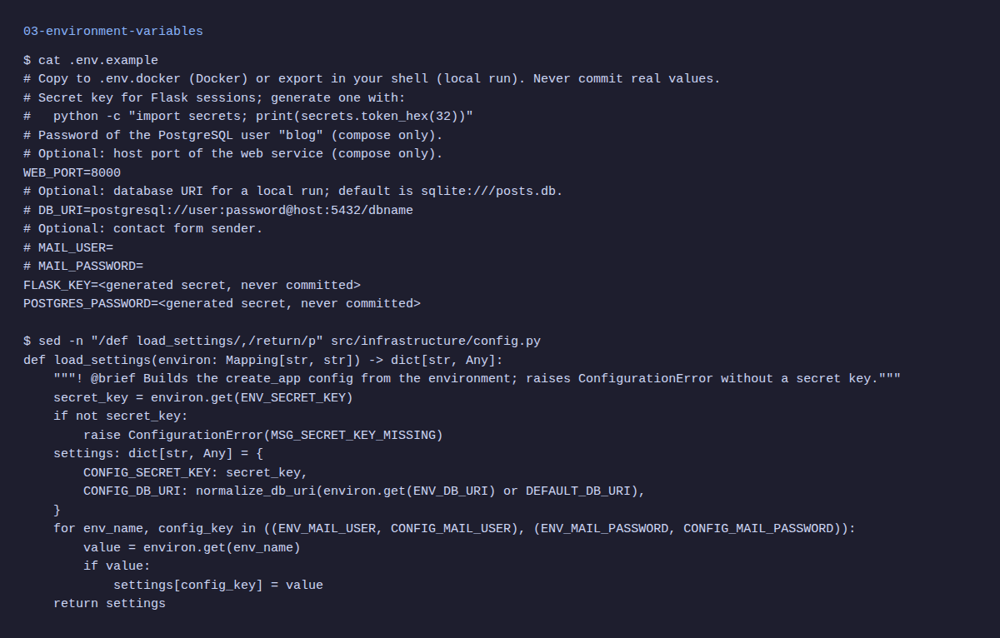

### 4. Serve the app with gunicorn and a Procfile

Flask's built-in server is only for development. A WSGI server such as gunicorn talks HTTP to the world and calls the Flask `app`. The `Procfile` line `web: gunicorn main:app` tells the host which command starts the web process.

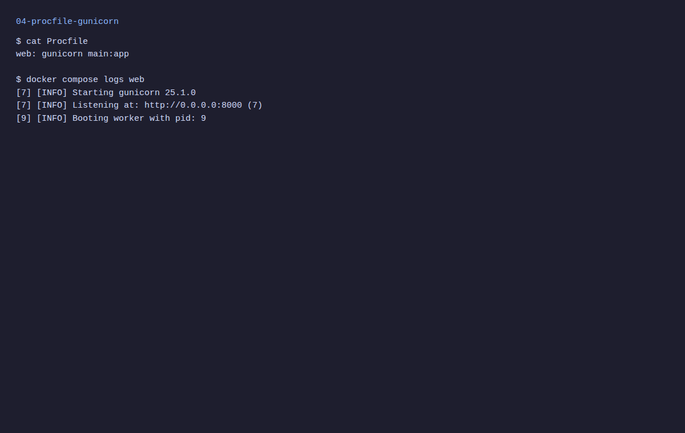

### 5. Push the project to the git host

The repository on the git host is the single source the deployment is built from. A `.gitignore` keeps the virtual environment, the database file and secrets out of it.

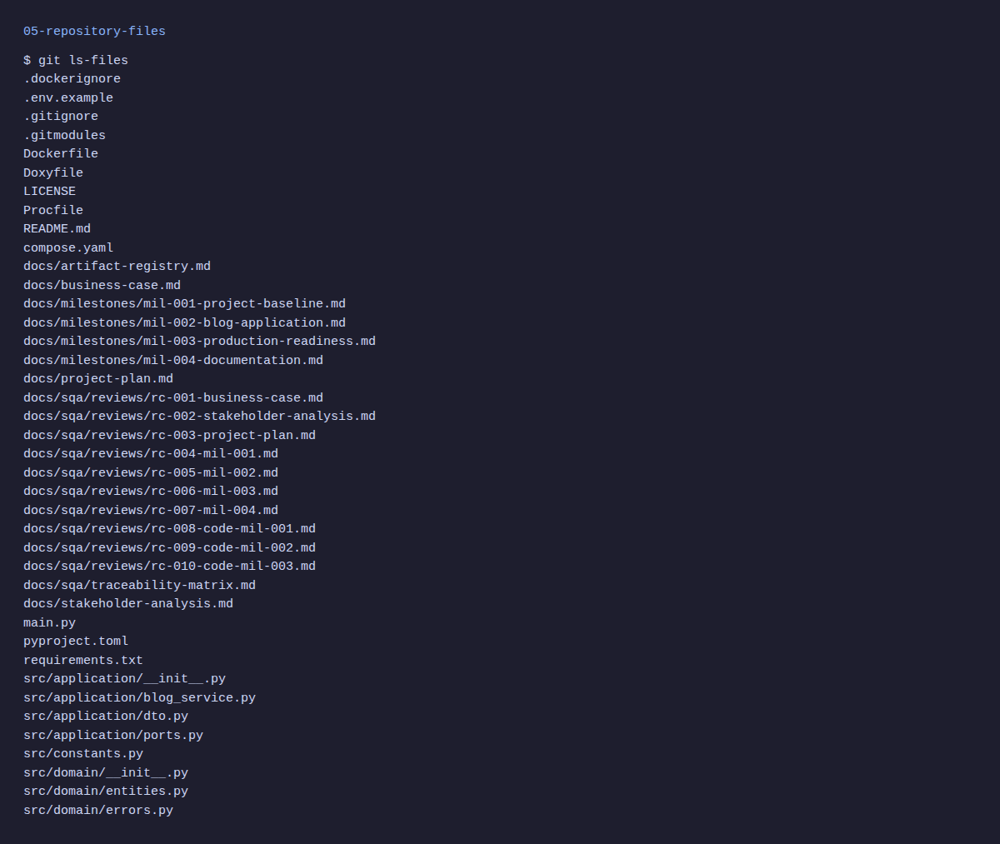

### 6. Host the app in containers

Heroku no longer has a free plan, so Docker takes its place. The `Dockerfile` builds the image and `compose.yaml` starts the blog together with its database. The same image can run on any machine with Docker.

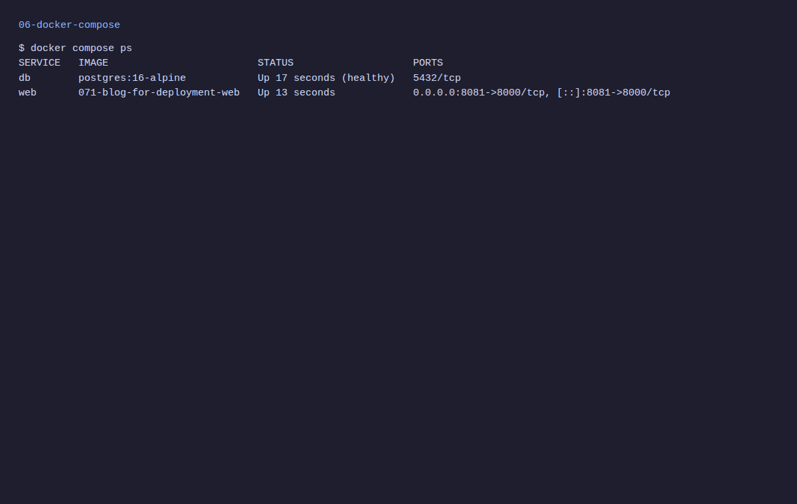

### 7. Upgrade SQLite to PostgreSQL

SQLite is a single file and can be lost when a host moves the file system. PostgreSQL is a real database server. Because SQLAlchemy hides the difference, only the `DB_URI` changes; the code stays the same. `psycopg` is the driver.

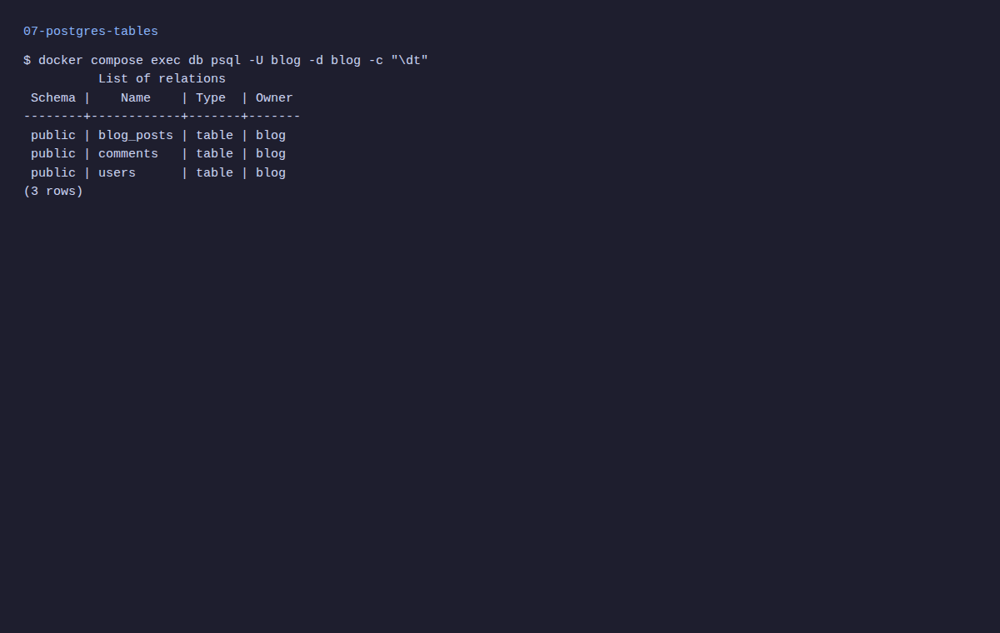

### 8. Go live: register, sign in and write the first post

On an empty database the first registered user becomes the administrator and can write posts. Other users can read and comment. These pages show the blog running from the container with PostgreSQL.

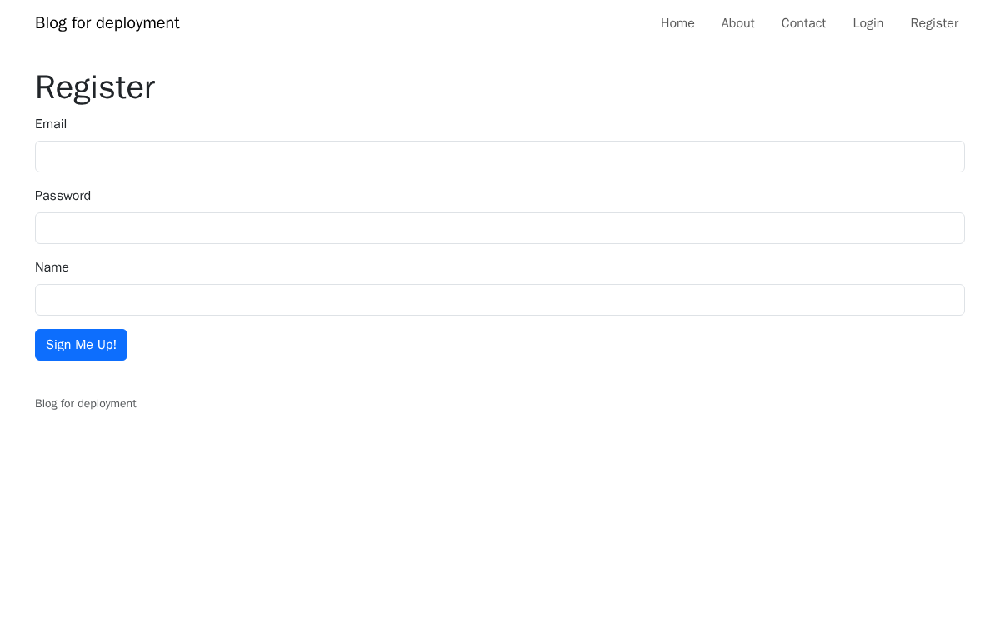

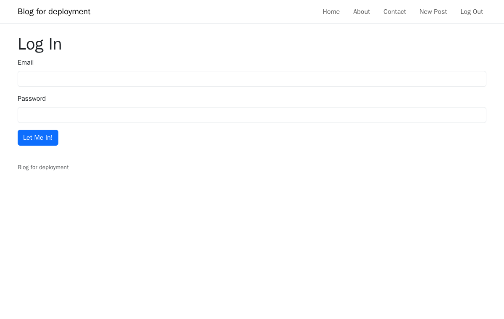

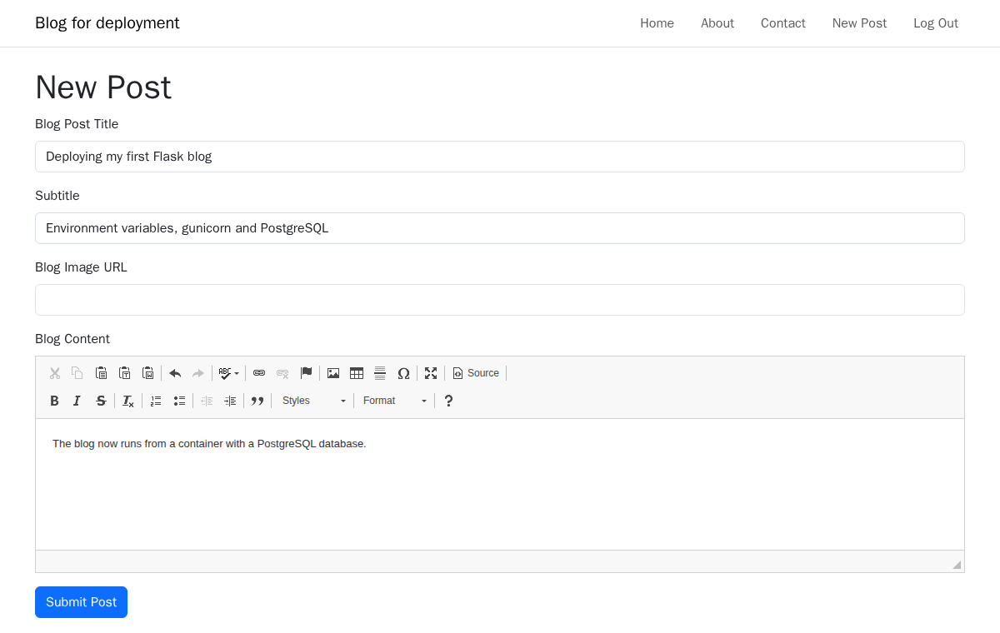

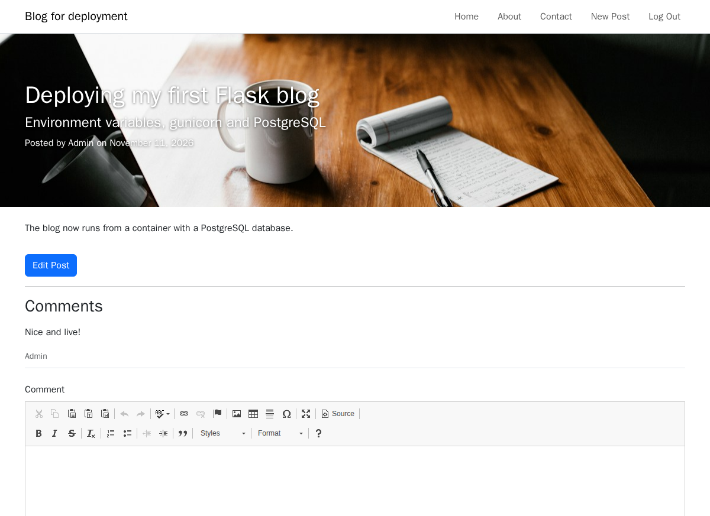

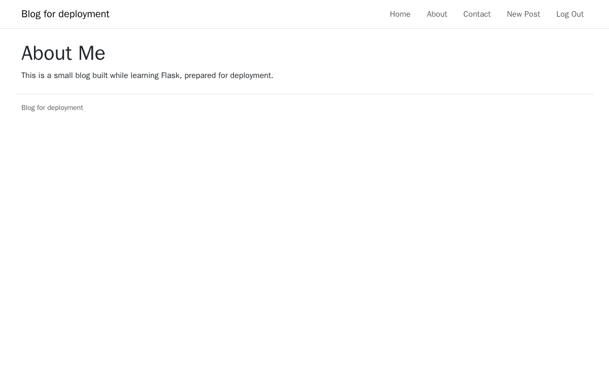

### 9. Check the result with tests

The pytest suite proves the blog, the configuration and the Procfile still behave after the move. Run it before every push.

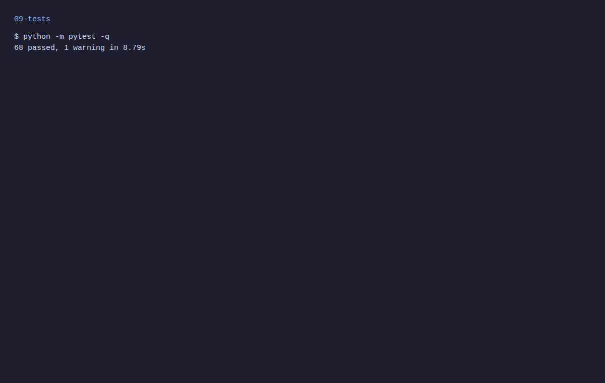

## 🧪 Tests

```bash
python -m pytest
```

Static scan before every push (the project uses opengrep):

```bash
~/.opengrep/cli/latest/opengrep.exe scan --config auto --exclude framework --exclude .venv --error .
```

## 📄 License

See [LICENSE](./LICENSE).

## 🔗 Links

- [Repository][repository]
- [Documentation][documentation]
- [Issue tracker][issues]

## 📎 Appendix: Project documents

| Document | What it tells you |
| --- | --- |
| [AGENTS.md][agents] | The rules AI agents follow in this repository |
| [Business Case][BC-001] | Why the project exists, its scope and success criteria |
| [Stakeholder Analysis][SA-001] | Who is involved; the stakeholder IDs used for owners and reviewers |
| [Project Plan][PP-001] | The gateways and their schedule |
| [Milestones][milestones] | One document per gateway: Go/No-Go criteria and tasks |
| [Artifact registry][registry] | Where each artifact type lives, the next version, the PO language and domain |
| [Traceability matrix][TM-001] | How the artifacts link and when each was last reviewed |
| [Framework README][framework-readme] | The framework this project uses |
| [Framework changelog][framework-changelog] | What changed in each framework release |

---

[repository]: https://git.tirsystem.com/Tirsvad-Udemy-100-days-of-code/071-blog-for-deployment
[documentation]: https://git.tirsystem.com/Tirsvad-Udemy-100-days-of-code/071-blog-for-deployment/wiki
[issues]: https://git.tirsystem.com/Tirsvad-Udemy-100-days-of-code/071-blog-for-deployment/issues
[agents]: ./AGENTS.md
[BC-001]: ./docs/business-case.md
[SA-001]: ./docs/stakeholder-analysis.md
[PP-001]: ./docs/project-plan.md
[milestones]: ./docs/milestones/
[registry]: ./docs/artifact-registry.md
[TM-001]: ./docs/sqa/traceability-matrix.md
[framework-readme]: ./framework/README.md
[framework-changelog]: ./framework/CHANGELOG.md
