# Project Plan

## Metadata
| Key | Value |
| --- | --- |
| ID | PP-001 |
| CrossReference | [BC-001], [SA-001], [MIL-001], [MIL-002], [MIL-003], [MIL-004] |
| Language | en |
| Domain | it |

## Version History
| Date | Status | Author | Reviewer | Change | Commit |
| --- | --- | --- | --- | --- | --- |
| 2026-11-11 | Accepted | Jens Tirsvad Nielsen | S01 | Initial version | pending |

---

## Purpose

Schedules the four gateways that deliver the Day 71 blog repository. The Business Case sets no duration limit; the plan fixes a short window so that each milestone gets its own pull request.

## Planning Assumptions

- The plan starts 2026-11-11 and ends by 2026-11-14 (source: S01 in the first prompt; no deadline in [BC-001] Constraints).
- One pull request per milestone, merged after green checks (autonomous mode, `AGENTS.md`).
- Communication follows [SA-001]: pull request per milestone (COM-001).

## Gateway Schedule

| Gateway | Document | Window | Decision date | Owner | Stories | Main deliverable | Milestone |
| --- | --- | --- | --- | --- | --- | --- | --- |
| Project baseline | [MIL-001] | 2026-11-11 | 2026-11-11 | S01 | none (technical tasks) | Configuration, ignore rules, Doxyfile, repository metadata | |
| Blog application | [MIL-002] | 2026-11-11 | 2026-11-11 | S01 | none (technical tasks) | Flask blog with tests | |
| Production readiness | [MIL-003] | 2026-11-12 | 2026-11-12 | S01 | none (technical tasks) | Environment config, Procfile, Docker and PostgreSQL | |
| Documentation | [MIL-004] | 2026-11-12 to 2026-11-13 | 2026-11-13 | S01 | none (technical tasks) | README, screenshots, three-language wiki | |

```plantuml
@startgantt
Project starts 2026-11-11
[Project baseline] starts 2026-11-11 and ends 2026-11-11
[Blog application] starts 2026-11-11 and ends 2026-11-11
[Production readiness] starts 2026-11-12 and ends 2026-11-12
[Documentation] starts 2026-11-12 and ends 2026-11-13
[MIL-001 Go/No-Go] happens 2026-11-11
[MIL-002 Go/No-Go] happens 2026-11-11
[MIL-003 Go/No-Go] happens 2026-11-12
[MIL-004 Go/No-Go] happens 2026-11-13
@endgantt
```



## Scope Coverage

| Business Case scope item | Gateway |
| --- | --- |
| Blog application, its tests and Doxygen comments with a `Doxyfile` | [MIL-001] (Doxyfile), [MIL-002] (application, tests) |
| `pyproject.toml`, `requirements.txt`, `.gitignore`, `Procfile`, `Dockerfile`, compose file | [MIL-001], [MIL-003] |
| README from the framework template and a wiki in en, da, ms | [MIL-004] |
| Repository description and topics | [MIL-001] |

## Dependencies

```
MIL-001 -> MIL-002 -> MIL-003 -> MIL-004
```

A No-Go on a gateway moves every later gateway and the end date by the days needed to fix it; S01 decides the new end date and records it as a new Version History row.

## Plan Risks

| Risk | Impact | Mitigation |
| --- | --- | --- |
| The pinned SQLAlchemy 2.1.0b1 behaves differently from 2.0 (BC risk 1) | MIL-002 slips | Develop and test against the pinned version from the first task |
| Docker image pulls are slow or blocked (BC risk 3) | Screenshots in MIL-004 slip | Build the screenshot container early in MIL-003 |

## Open Issues

- None.

---

[BC-001]: ./business-case.md
[SA-001]: ./stakeholder-analysis.md
[MIL-001]: ./milestones/mil-001-project-baseline.md
[MIL-002]: ./milestones/mil-002-blog-application.md
[MIL-003]: ./milestones/mil-003-production-readiness.md
[MIL-004]: ./milestones/mil-004-documentation.md
